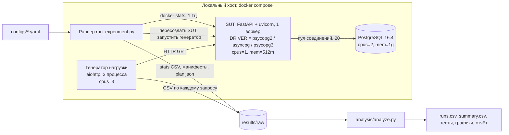
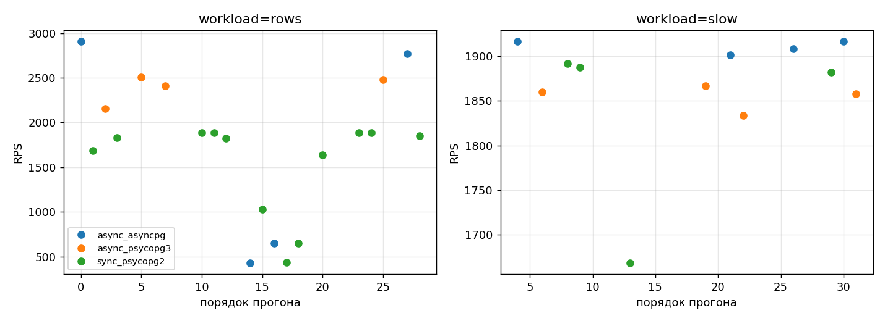

# Практическая работа № 3. Критерии научности исследования и проектирование экспериментального стенда

**Тема ВКР:** Исследование влияния асинхронных драйверов баз данных на производительность FastAPI-приложений

**Авторы:** Диана Савельева, Елизавета Захаренко (работа выполнена в паре)

**Репозиторий:** https://github.com/zaharenkoliza/python_lab_3

---

## Содержание

1. Тема ВКР и постановка задачи
2. Подборка статей и сводная таблица анализа
3. Синтез: практика экспериментов в предметной области
4. Критерии научности, исследовательский вопрос, гипотезы, переменные
5. Обеспечение проверяемости и сценарий проверки
6. Проект экспериментального стенда
7. Список литературы

---

## 1. Тема ВКР и постановка задачи

Веб-сервисы на Python обычно строят на FastAPI. Фреймворк поддерживает два способа обработки запросов. Синхронные обработчики (`def`) выполняются в пуле потоков. Асинхронные обработчики (`async def`) выполняются в цикле событий `asyncio`. Выбор драйвера базы данных определяет, какой из способов можно использовать на практике: `psycopg2` блокирует поток на время запроса, а `asyncpg` и `psycopg 3` в асинхронном режиме отдают управление циклу событий. В практических руководствах часто утверждается, что асинхронный драйвер «быстрее». При этом такие утверждения обычно опираются на единичные прогоны без операционального определения «быстрее», без контроля размера пула соединений и без оценки разброса (см. раздел 3).

**Цель работы** — измерить, как выбор драйвера БД (синхронный `psycopg2` в пуле потоков, асинхронные `asyncpg` и `psycopg 3`) влияет на пропускную способность и задержку FastAPI-сервиса при разной нагрузке, и показать, при каких условиях эффект практически значим.

**Задача данной практической работы** — не провести исследование целиком, а спроектировать и проверить экспериментальный стенд: определить, что и как будет измеряться, по каким критериям результат будет считаться научно обоснованным, и как его сможет проверить другой человек. Стенд реализован в репозитории и проверен пилотным запуском (раздел 6.8).

---

## 2. Подборка статей и сводная таблица анализа

### 2.1. Подборка

Поиск велся по открытым источникам и страницам издательств (ACM DL, IEEE Xplore, Springer, arXiv) по сочетаниям «FastAPI / asyncio / asyncpg / psycopg» со словами *benchmark, evaluation, empirical, reproducibility*. Рецензируемых работ именно про асинхронные драйверы БД в Python найти не удалось. Практические сравнения сосредоточены в технических статьях и репозиториях. Поэтому подборка состоит из двух групп:

* **методологические работы по измерению производительности ПО** ([1]–[5]) — рецензируемые, определяют, как правильно ставить такие эксперименты;
* **прикладные сравнения Python-фреймворков и драйверов** ([6]–[9]) — ближе всего к теме, но разного качества.

| Требование задания | Статьи | Выполнено |
|---|---|---|
| не менее 6 статей | [1]–[9] (9 источников) | да |
| не менее 4 с экспериментом | [1], [2], [3], [5], [6], [7], [8], [9] | да (8) |
| не менее 3 за последние 5 лет (с ноября 2021) | [5] (2023), [6] (2025), [8] (2024), [9] (2025–2026) | да (4) |
| не менее 2 рецензируемых (ACM, IEEE, Springer, Elsevier и др.) | [1], [2], [3] (ACM), [4] (IEEE), [5] (Springer) | да (5) |
| желательно артефакт | [5] (Zenodo), [7] и [8] (код на GitHub) | да (3) |

Источник [4] опубликован в 2021 году (IEEE TSE, т. 47, № 8), а [7] — в 2020 году, поэтому в счёт «последних 5 лет» они не включены.

### 2.2. Источники анализа и их полнота

1. Полные тексты прочитаны для [1] (рукопись автора), [5] (полный текст на arXiv), [6] (PDF журнала), [7] и [8] (страницы целиком, включая ссылки на код).
2. Для [2], [3] и [4] полный текст издателей недоступен (ACM и IEEE отвечают отказом на автоматическое чтение). Эти карточки составлены по аннотациям, метаданным и общеизвестному содержанию работ. Поля, которых там нет, записаны как «не указано».
3. Для [9] страница ResearchGate недоступна для автоматического чтения; использованы название и описание. Авторов, год и методику необходимо уточнить по самой странице.
4. Оценки воспроизводимости для [2]–[4] и [9] предварительные.

Шкала воспроизводимости: 0 — описания недостаточно даже для повторения идеи; 1 — методика описана, артефактов нет; 2 — есть код или данные, но окружение не зафиксировано; 3 — есть артефакт с зафиксированным окружением.

### 2.3. Сводная таблица (кратко)

| № | Источник | Тип | Год | Эксперимент | Артефакт | Воспроизводимость |
|---|---|---|---|---|---|---|
| 1 | Kalibera, Jones | ACM, ISMM | 2013 | да | не указано | 1 |
| 2 | Georges, Buytaert, Eeckhout | ACM, OOPSLA | 2007 | да | не указано | 1 |
| 3 | Mytkowicz et al. | ACM, ASPLOS | 2009 | да | не указано | 1 |
| 4 | Papadopoulos et al. | IEEE TSE | 2021 | да (анализ литературы и пример) | не указано | 1 |
| 5 | Traini et al. | Springer, EMSE | 2023 | да | Zenodo | 2 |
| 6 | Bednarz, Miłosz | журнал JCSI | 2025 | да | не указано | 1 |
| 7 | Grinberg | техническая статья | 2020 | да | код на GitHub | 2 |
| 8 | Arteaga | техническая статья | 2024 | да | код на GitHub | 2 |
| 9 | Препринт Django vs FastAPI | препринт | 2025–2026 | да (по описанию) | не указано | 1 |

### 2.4. Подробный анализ по статьям

#### [1] Kalibera T., Jones R. Rigorous benchmarking in reasonable time (ISMM 2013)

| Поле | Содержание |
|---|---|
| Ссылка | Kalibera T., Jones R. Rigorous benchmarking in reasonable time // Proc. ISMM'13. ACM, 2013. С. 63–74. DOI: 10.1145/2464157.2464160 |
| Вопрос / гипотеза | Как выбрать число повторений на каждом уровне эксперимента (сборка, запуск, итерация), чтобы получить заданную точность за минимальное время |
| Объект | Бенчмарки DaCapo (версии 2006 и 2009) на OpenJDK 7u2 и Jikes RVM; SPEC CPU, собранный gcc 4.7 |
| Независимые переменные | Число повторений на уровнях: пересборка VM или бенчмарка, запуск процесса, итерация внутри запуска; платформа (5 штук, из них 3 в основных примерах) |
| Зависимые переменные | Пропускная способность (время выполнения), оценки вариации, доверительный интервал размера эффекта |
| Контролируемые условия | Отключены системные службы, способные влиять на измерения; платформы описаны таблицей (Ubuntu Linux 2.6.35–3.0.0; AMD Opteron, Intel Xeon, Core i7, Core 2, Pentium 4; ОЗУ 4–64 ГБ) |
| Стенд | Пять физических машин, DaCapo и SPEC CPU |
| Методика | Модель стоимости эксперимента и «поваренная книга» выбора числа повторений. Прогрев определяется один раз вручную для каждой связки «бенчмарк, VM, платформа» по графику итераций (до состояния независимости итераций) |
| Статистическая обработка | Разложение дисперсии по уровням повторения, доверительный интервал размера эффекта |
| Угрозы валидности | Работа посвящена Java и C-бенчмаркам, не веб-сервисам. Прогрев определяется вручную и зависит от VM. Для HTTP-нагрузки перенос не проверен (замечание авторов отчёта) |
| Артефакты | не указано (доступна рукопись автора) |
| Воспроизводимость | 1 — окружение описано подробно, но кода и данных нет |

#### [2] Georges A., Buytaert D., Eeckhout L. Statistically rigorous Java performance evaluation (OOPSLA 2007)

| Поле | Содержание |
|---|---|
| Ссылка | Georges A., Buytaert D., Eeckhout L. Statistically rigorous Java performance evaluation // Proc. OOPSLA'07. ACM, 2007. DOI: 10.1145/1297027.1297033 |
| Вопрос / гипотеза | Корректно ли в литературе сравнивают производительность Java-систем; как это делать с помощью статистики |
| Объект | Java-бенчмарки и виртуальные машины |
| Независимые переменные | Конфигурация JVM, бенчмарк; различаются режимы измерения: старт и установившееся состояние |
| Зависимые переменные | Время выполнения |
| Контролируемые условия | Не указано в доступном описании |
| Стенд | Набор бенчмарков, несколько запусков JVM |
| Методика | Несколько запусков, отдельное измерение установившегося состояния |
| Статистическая обработка | Доверительные интервалы, ANOVA, тест Тьюки при сравнении нескольких систем |
| Угрозы валидности | Те же, что в [1]: работа про JVM, не про сетевую нагрузку (замечание авторов отчёта) |
| Артефакты | не указано |
| Воспроизводимость | 1 |

#### [3] Mytkowicz T., Diwan A., Hauswirth M., Sweeney P. Producing wrong data without doing anything obviously wrong! (ASPLOS 2009)

| Поле | Содержание |
|---|---|
| Ссылка | Mytkowicz T. et al. Producing wrong data without doing anything obviously wrong! // Proc. ASPLOS'09. ACM, 2009. DOI: 10.1145/1508244.1508275 |
| Вопрос / гипотеза | Могут ли «незначимые» детали окружения систематически искажать результаты измерений |
| Объект | Программные бенчмарки и компиляторные оптимизации |
| Независимые переменные | Размер переменных окружения, порядок линковки |
| Зависимые переменные | Время выполнения |
| Контролируемые условия | Варьируются как раз те условия, которые обычно не фиксируют |
| Стенд | Несколько машин и компиляторов |
| Методика | Многократные запуски при систематическом изменении «нейтральных» параметров окружения |
| Статистическая обработка | Сравнение распределений при разных значениях параметров окружения |
| Угрозы валидности | Авторы показывают смещение измерений (measurement bias). Замечание авторов отчёта: для сервисов в контейнерах аналог — число ядер, фоновые процессы, версия образа |
| Артефакты | не указано |
| Воспроизводимость | 1 |

#### [4] Papadopoulos A. V. et al. Methodological principles for reproducible performance evaluation in cloud computing (IEEE TSE, 2021)

| Поле | Содержание |
|---|---|
| Ссылка | Papadopoulos A. V., Versluis L., Bauer A. et al. Methodological principles for reproducible performance evaluation in cloud computing // IEEE Trans. Softw. Eng. 2021. Т. 47, № 8. С. 1528–1543. DOI: 10.1109/TSE.2019.2927908 |
| Вопрос / гипотеза | Как измерять и описывать производительность в облаке, чтобы результаты были воспроизводимы; насколько этим принципам следует сообщество |
| Объект | Публикации с экспериментами в облаке (обзор 2012–2017 гг.); бенчмарк SPEC Cloud IaaS |
| Независимые переменные | Не применимо: работа формулирует восемь принципов и проверяет по ним публикации |
| Зависимые переменные | Доля публикаций, следующих принципам |
| Контролируемые условия | Не указано |
| Стенд | Систематический обзор и разбор SPEC Cloud IaaS на соответствие принципам |
| Методика | Контрольный перечень из восьми принципов, применённый к литературе |
| Статистическая обработка | Подсчёт долей |
| Угрозы валидности | Авторы признают, что работа касается технической воспроизводимости. Замечание авторов отчёта: принципы сформулированы для облаков, часть из них (изоляция ресурсов, повторения, отчётность) переносится на локальный стенд |
| Артефакты | не указано |
| Воспроизводимость | 1 |

#### [5] Traini L., Cortellessa V., Di Pompeo D., Tucci M. Towards effective assessment of steady state performance in Java software: are we there yet? (Empirical Software Engineering, 2023)

| Поле | Содержание |
|---|---|
| Ссылка | Traini L., Cortellessa V., Di Pompeo D., Tucci M. Towards effective assessment of steady state performance in Java software: are we there yet? // Empirical Software Engineering. 2023. Т. 28, № 1, ст. 13. DOI: 10.1007/s10664-022-10247-x; arXiv:2209.15369 |
| Вопрос / гипотеза | Пять вопросов: выходят ли JMH-микробенчмарки на установившееся состояние и за какое время; как оно влияет на разброс между запусками; насколько точен прогрев, заданный разработчиками; насколько эффективны критерии динамической реконфигурации; лучше ли она конфигураций разработчиков |
| Объект | 586 JMH-микробенчмарков из 30 открытых Java-проектов на GitHub (более 100 звёзд, не менее 20 бенчмарков) |
| Независимые переменные | Число запусков (форков) и итераций, длина прогрева, критерии остановки (CV, RCIW, KLD) |
| Зависимые переменные | Момент выхода на установившееся состояние, разброс времени выполнения, качество оценки прогрева |
| Контролируемые условия | Один сервер без виртуализации: два Intel Xeon E5-2650 v3, 40 ядер, 80 ГиБ, Ubuntu 18.04.2; JDK 8u241 или 11.0.6; куча 8 ГБ; отключены Turbo Boost, hyper-threading, ASLR; фоновые процессы ограничены. Версия JMH не указана |
| Стенд | JMH, 10 запусков на бенчмарк, по 3000 итераций по 100 мс, без прогрева; около 9 млрд вызовов и 93 суток вычислений |
| Методика | Установившееся состояние определяется по последним 500 измерениям, попавшим в один сегмент (метод PELT); конфигурации разработчиков и динамические вычисляются после эксперимента |
| Статистическая обработка | Бутстрэп-доверительные интервалы (10 000 повторов, 95%), тест Уилкоксона (ранговая сумма), размер эффекта Варгхи — Делани |
| Угрозы валидности | Авторы указывают: конфигурации выводятся апостериори; установившееся состояние определяется только по времени выполнения; один сервер и только Java-проекты с JMH; метод предполагает независимость наблюдений. Замечание авторов отчёта: для нас это аргумент измерять прогрев, а не назначать его |
| Артефакты | Пакет для репликации на Zenodo: https://doi.org/10.5281/zenodo.7058361 (по разделу Data Availability; сам архив мы не открывали) |
| Воспроизводимость | 2 — код и данные доступны, окружение описано подробно, но контейнера или lock-файлов в описании нет |

#### [6] Bednarz B., Miłosz M. Benchmarking the performance of Python web frameworks (Journal of Computer Sciences Institute, 2025)

| Поле | Содержание |
|---|---|
| Ссылка | Bednarz B., Miłosz M. Benchmarking the performance of Python web frameworks // Journal of Computer Sciences Institute. 2025. Т. 36. С. 336–341. Получено 13.05.2025. URL: https://ph.pollub.pl/index.php/jcsi/article/download/7738/5148/36459 |
| Вопрос / гипотеза | Гипотеза: FastAPI — самый производительный из Django (с DRF), Flask и FastAPI |
| Объект | Пять приложений: FastAPI + SQLModel, FastAPI + sqlite3, Flask + SQLAlchemy, Flask + sqlite3, Django + DRF; СУБД SQLite |
| Независимые переменные | Стек (5 уровней); сценарий: GET /hello (50 пользователей, 10 с), POST /echo (100 пользователей, 15 с) и CRUD-операции с 1000 или 100 запросами |
| Зависимые переменные | Запросов в секунду для GET и POST; среднее время ответа для CRUD (мс) |
| Контролируемые условия | Один компьютер: Intel Core i7-8750H, 16 ГБ, Windows 10; Docker Engine 24.0.2; Python 3.11; Gunicorn 23.0.0 с 2 воркерами и 2 потоками (воркер gthread для Flask и Django, UvicornWorker для FastAPI); таблица версий приведена; база из 1500 записей |
| Стенд | Автоматический скрипт: запуск контейнера, пауза 20 с, загрузка данных, прогрев (20 пользователей, 10 с), пауза 5 с, затем сценарии с паузами по 3 с; генератор нагрузки k6; контроль ресурсов: CPU 100% не достигался |
| Методика | Каждый тест повторён 5 раз, результаты усреднены |
| Статистическая обработка | Среднее по пяти повторениям; разброс, доверительные интервалы и тесты значимости не указаны |
| Угрозы валидности | Авторы признают, что конфигурация сервера одинакова, но не оптимальна для каждого фреймворка. Замечания авторов отчёта: SQLite не позволяет изучать драйвер сетевой СУБД; усредняется среднее, хвост задержки (p95, p99) не измеряется; Docker на Windows добавляет неучтённый шум; разные типы воркеров смешиваются с фреймворком |
| Артефакты | не указано |
| Воспроизводимость | 1 — окружение и методика описаны подробно, но кода и данных нет |

Из этой работы мы берём структуру процедуры (контейнер, пауза, прогрев, отдельные сценарии, пять повторений), но отказываемся от усреднения без разброса и от среднего времени вместо перцентилей.

#### [7] Grinberg M. Ignore all web performance benchmarks, including this one (технический блог, 2020)

| Поле | Содержание |
|---|---|
| Ссылка | Grinberg M. Ignore all web performance benchmarks, including this one. 15.09.2020 (обновлено 27.10.2020). URL: https://blog.miguelgrinberg.com/post/ignore-all-web-performance-benchmarks-including-this-one |
| Вопрос / гипотеза | Верно ли, что асинхронный Python не быстрее синхронного, как утверждал бенчмарк Cal Paterson «Async Python is Not Faster» |
| Объект | Повторный запуск чужого бенчмарка с исправлениями: микросервис с одним запросом к PostgreSQL (по первичному ключу, с добавленной задержкой 20 мс); WSGI (Flask, Bottle, Falcon) и asyncio (aiohttp, Sanic, Quart, Starlette, Tornado, FastAPI) фреймворки, серверы Gunicorn, uWSGI, Gevent, Meinheld, Uvicorn, Hypercorn и др. |
| Независимые переменные | Фреймворк и сервер; затем четыре параметра (число сессий БД, задержка запроса, число клиентов, воркеры) в трёх сценариях конфигурации |
| Зависимые переменные | Пропускная способность как кратное отношение к базовому варианту (Flask + Gunicorn), p50 и p99 задержки (мс), число использованных сессий БД |
| Контролируемые условия | Docker-контейнеры; 100 одновременных клиентов; nginx перед сервисом; пул pgbouncer на 100 сессий; 6 воркеров для асинхронных вариантов и 19 для синхронных (подобраны экспериментом); uvloop. Версии ПО и характеристики железа не указаны |
| Стенд | Apache Bench, nginx, pgbouncer, PostgreSQL |
| Методика | Длительность, число повторений и прогрев не указаны |
| Статистическая обработка | Не указана; результат — таблицы кратных отношений |
| Угрозы валидности | Автор называет бенчмарки «подтасованными»: изменение числа сессий БД, задержки запроса и числа клиентов переворачивает ранжирование (асинхронные варианты в 3–6 раз быстрее в одной конфигурации и медленнее в другой). Лучший вариант лишь около 60% быстрее базового. Замечание авторов отчёта: нет повторений и разброса |
| Артефакты | Код: https://github.com/miguelgrinberg/python-web-perf |
| Воспроизводимость | 2 — код есть, но версии и железо не зафиксированы |

Для нас это существенное предупреждение: результат сравнения sync и async зависит от параметров пула и нагрузки. Поэтому размер пула у нас контролируемая переменная, а не настройка по умолчанию.

#### [8] Arteaga F. Psycopg 3 vs Asyncpg (технический блог, 01.03.2024)

| Поле | Содержание |
|---|---|
| Ссылка | Arteaga F. Psycopg 3 vs Asyncpg. 01.03.2024. URL: https://fernandoarteaga.pages.dev/blog/psycopg-vs-asyncpg (полное имя автора на странице не указано) |
| Вопрос / гипотеза | Какой из драйверов быстрее в FastAPI-приложении при чтении разного числа строк |
| Объект | Три эндпоинта: psycopg 3 sync, psycopg 3 async, asyncpg |
| Независимые переменные | Драйвер (3); число читаемых строк: 50, 250, 1000, 5000 |
| Зависимые переменные | Задержка (средняя, стандартное отклонение, максимум), запросов в секунду, объём переданных данных, ошибки сокетов (по выводу wrk) |
| Контролируемые условия | FastAPI 0.109.2, psycopg 3.1.18, asyncpg 0.29.0, PostgreSQL 16 в Docker. Версия Python, железо, ОС, параметры пула не указаны |
| Стенд | wrk: 12 потоков, 400 соединений, 2 минуты на тест |
| Методика | Число повторений и прогрев не указаны |
| Статистическая обработка | Нет; приведены значения одного прогона и ранжирование по «медалям» |
| Угрозы валидности | Явных оговорок о методике авторов нет. Замечания авторов отчёта: при 400 соединениях отмечены ошибки сокетов (в тесте 5000 строк — тысячи тайм-аутов), которые не обсуждаются; в таблице тестов 2 и 3 для синхронного варианта совпадают значения Req/Sec (вероятная ошибка копирования); заключение «asyncpg лучше во всех случаях» не согласуется с таблицами (в тестах 3 и 4 впереди psycopg async) |
| Артефакты | Код: https://github.com/FernandoArteaga/fastapi-postgres-benchmark |
| Воспроизводимость | 2 — код и версии основных пакетов есть, железо и окружение полностью не зафиксированы |

Это источник, наиболее близкий к теме ВКР: из него взят набор факторов «драйвер и объём выборки». Отличия нашего стенда: повторения, фиксированные ресурсы и пул, контроль ошибок, статистика.

#### [9] Препринт: сравнение монолитной (Django) и микросервисной (FastAPI) архитектур для асинхронных API (ResearchGate, 2025–2026)

| Поле | Содержание |
|---|---|
| Ссылка | A Performance and Scalability Evaluation of Monolithic (Django) vs. Microservice (FastAPI) Architectures for Asynchronous API Workloads in Python. ResearchGate, препринт. https://www.researchgate.net/publication/404180481 (страница закрыта для автоматического чтения, ответ 403; авторов и год уточнить вручную) |
| Вопрос / гипотеза | Как архитектура влияет на производительность и масштабируемость при асинхронных нагрузках (по названию и описанию) |
| Объект | Django-монолит и FastAPI-микросервис |
| Независимые переменные | Архитектура (по описанию) |
| Зависимые переменные | Производительность, масштабируемость |
| Контролируемые условия | Docker (по описанию); остальное не указано |
| Стенд | Apache JMeter в Docker-контейнере (по описанию) |
| Методика | Не указано (полный текст недоступен) |
| Статистическая обработка | Не указано |
| Угрозы валидности | Меняется сразу и фреймворк, и архитектура, поэтому эффект нельзя приписать одному фактору (по названию работы) |
| Артефакты | не указано |
| Воспроизводимость | 1 (предварительно; полный текст не прочитан) |

---

## 3. Синтез: практика экспериментов в предметной области

**Что принято измерять.** В прикладных работах [6]–[9] измеряют пропускную способность (запросов в секунду) и задержку. Задержку чаще дают как среднее, реже — как перцентили. Рецензируемые методологические работы [1]–[5] сходятся в том, что результат производительности — это распределение, а не число, и что измерять нужно установившееся состояние после прогрева.

**Как принято измерять.** Нагрузочный инструмент (k6, JMeter, wrk) выдаёт агрегированные значения за один прогон. Варьируется обычно один фактор: фреймворк, драйвер или архитектура. Подробность описания окружения сильно различается: в [6] приведены железо, версии и процедура прогрева, а в [7] и [8] железо не указано.

**Типичные ошибки.**

1. *Один прогон или усреднение без разброса.* В [7] и [8] число повторений не указано, в [6] тесты повторены 5 раз, но приведено только среднее без разброса. По [1] и [2] такие результаты нельзя считать надёжными, потому что дисперсия между запусками может быть сопоставима с заявленной разницей.
2. *Нет операционального определения «быстрее».* Среднее время скрывает хвост распределения, а для сервиса именно p95 и p99 определяют пользовательский опыт.
3. *Смешение факторов.* В [9] вместе с фреймворком меняется архитектура, в [6] — всё приложение сразу. Влияние драйвера выделить невозможно.
4. *Не контролируются ресурсы и размер пула.* При ограниченном пуле соединений пропускная способность определяется пулом, а не драйвером (раздел 6.4). В [8] параметры пула не указаны. В [7] автор прямо показывает, что изменение числа сессий БД, задержки запроса и числа клиентов переворачивает ранжирование «sync против async».
5. *Не проверяется сам генератор нагрузки и не обсуждаются ошибки.* В [8] при 400 соединениях отмечены тысячи тайм-аутов, которые в тексте не разбираются. Если генератор упирается в процессор, измеряется он, а не сервис. В нашем пилоте это произошло и было исправлено (раздел 6.8). Это подтверждает, что проверка нужна.
6. *Прогрев не отделяется от измерения* [5], [2].
7. *Скрытые факторы окружения* [3]: версии, число ядер, фоновые процессы.
8. *Нет статистики*: нет интервалов и тестов значимости, нет размера эффекта.

**Чья методика лучше.** Наиболее строги [1] и [2]: они требуют несколько запусков, разделяют уровни повторений и дают доверительные интервалы. Работа [4] даёт перечень принципов отчётности и подходит как контрольный список для оценки собственного стенда. Из прикладных работ [6] лучше всех описана процедура (контейнер, пауза, прогрев, пять повторений, версии), но усреднение без разброса и средняя задержка вместо перцентилей снижают ценность результата. Работа [8] ближе всего по постановке (драйверы, переменный объём данных, опубликован код), но в ней нет повторений и контроля ресурсов. Работа [7] полезна как предостережение: результат зависит от нагрузки и настроек, и обобщать его нельзя.

**Вывод для нашей работы.** Берём из методологических работ: повторения и разложение дисперсии [1], интервалы и непараметрические тесты вместо сравнения средних [2], явный прогрев [5], перечень принципов отчётности [4], контроль «нейтральных» условий окружения [3]. Берём из прикладных: структуру процедуры прогона [6], набор факторов (драйвер, объём выборки) [8] и сравнение sync/async [7]. Дополнительно вводим: фиксированные ресурсы контейнеров, одинаковый размер пула, рандомизацию порядка прогонов, A/A-тест и проверку генератора нагрузки.

---

## 4. Критерии научности, исследовательский вопрос, гипотезы, переменные

### 4.1. Исследовательский вопрос и гипотезы

**RQ.** Как выбор драйвера БД (синхронный `psycopg2` в пуле потоков, асинхронные `asyncpg` и `psycopg 3`) влияет на пропускную способность и задержку p95 FastAPI-сервиса, ограниченного одним процессорным ядром, при разной конкурентности и разном типе запросов?

**Основная гипотеза (асинхронные драйверы против синхронного).**

* **H₀:** при равных условиях медианы p95 и пропускной способности по прогонам для асинхронных драйверов и для `psycopg2` не различаются.
* **H₁:** при конкурентности ≥ 50 для запросов, выбирающих строки (`rows`), асинхронные драйверы дают пропускную способность выше и p95 ниже, чем `psycopg2`. Ожидаемая величина — не менее 10%.

**Вспомогательные гипотезы.**

* **H₂.** Для запросов `slow` (10 мс ожидания в БД) разницы между драйверами нет, пока пропускная способность ограничена размером пула: 20 соединений / 0,01 с ≈ 2000 запросов/с для любого драйвера. Это проверяемое предсказание: если асинхронный драйвер превзойдёт этот предел заметно, значит модель неверна.
* **H₃.** При конкурентности 10 различие между драйверами меньше порога практической значимости, так как очередей ещё нет.
* **H₄.** Между `asyncpg` и `psycopg 3` в режиме `rows` есть различие. Направление: `asyncpg` быстрее, поскольку `asyncpg` реализует протокол PostgreSQL напрямую, а `psycopg 3` построен поверх libpq. Это ожидание, а не установленный факт.

**Фальсифицируемость.** Гипотеза H₁ опровергается, если для обеих нагрузок при конкурентности ≥ 50 доверительный интервал отношения медиан p95 содержит 1 либо отличие медианы от базового варианта меньше 10%. Гипотеза H₂ опровергается, если для `slow` при конкурентности ≥ 50 асинхронный драйвер даёт прирост пропускной способности более 10% относительно `psycopg2` и этот прирост значим после поправки Холма.

### 4.2. Переменные

**Независимые**

| Фактор | Уровни | Комментарий |
|---|---|---|
| Драйвер | `sync_psycopg2`, `async_asyncpg`, `async_psycopg3` | основной фактор |
| Тип запроса | `rows` (выборка 100 строк и сериализация JSON), `slow` (`pg_sleep(0.01)`) | `rows` нагружает процессор, `slow` — ожидание ввода-вывода |
| Конкурентность | 10, 50, 200 виртуальных пользователей | замкнутая модель нагрузки, без пауз |

**Зависимые**

| Метрика | Определение | Единица | Как измеряется |
|---|---|---|---|
| p95 задержки | 95-й перцентиль времени от отправки запроса до получения полного ответа по успешным запросам за измеряемую часть прогона | мс | на стороне генератора, по каждому запросу |
| Пропускная способность | число успешных ответов 200 / длительность измеряемой части | запросов/с | генератор |
| p50, p99 | аналогично | мс | генератор |
| Доля ошибок | ответы не 200 и сбои соединения / все запросы | % | генератор |
| Загрузка процессора и память SUT | медиана значений `docker stats` за прогон | % ядра, МиБ | раннер |
| Загрузка процессора генератора | процессорное время процесса / время прогона, максимум по процессам | доля ядра | генератор |

**Контролируемые**

Версия образов и пакетов (раздел 6.2), 1 воркер uvicorn, ограничение SUT 1 ядром и 512 МиБ, размер пула соединений 20 (одинаков для всех драйверов), лимит потоков в пуле AnyIO равен размеру пула, один и тот же детерминированный набор данных (10 000 строк), одни и те же SQL-запросы и одинаковая сериализация, `fsync=off` в PostgreSQL (чтобы запись журнала не добавляла шум), `seed` для параметров запросов, пересоздание контейнера SUT перед каждым прогоном.

**Неконтролируемые, но учитываемые:** состояние хоста (температура, фоновые процессы), поэтому порядок прогонов рандомизируется, а A/A-тест оценивает уровень шума.

### 4.3. Критерии научности и их выполнение в работе

| Критерий | Как выполняется |
|---|---|
| Объективность и измеримость | Метрики определены в 4.2: что, чем и в каких единицах. Измерения делает генератор по каждому запросу, а не ручные наблюдения |
| Контроль переменных | Список контролируемых условий в 4.2; всё, что может исказить результат (размер пула, число потоков, ядра), зафиксировано в `docker-compose.yml` |
| Повторяемость (repeatability) | Мы сами на том же стенде получаем согласующийся результат: 10 повторений на конфигурацию; разброс между идентичными прогонами оценивается A/A-тестом (в пилоте выявлен дрейф среды, раздел 6.8) |
| Воспроизводимость (reproducibility) | Другой человек запускает наш артефакт: репозиторий с тегом, `uv.lock`, зафиксированные версии образов, одна команда запуска (раздел 5) |
| Реплицируемость (replicability) | Другой человек пишет свой сервис по описанию в 4.2 и 6.2 и получает согласующийся результат по направлению и порядку величины эффекта. Для этого описаны SQL-запросы, параметры пула и поведение генератора |
| Внутренняя валидность | Меняется только драйвер; всё остальное одинаково; порядок рандомизирован; контейнер SUT пересоздаётся перед каждым прогоном |
| Внешняя валидность | Ограничена: один тип СУБД, 1 ядро, один воркер, синтетические запросы. Выводы формулируются для этого класса нагрузок, а не «для FastAPI вообще» |
| Конструктная валидность | p95 по прогонам отражает хвост задержки для пользователя; пропускная способность считается по успешным ответам; генератор проверен, чтобы не быть узким местом |
| Статистическая валидность | Единица анализа — прогон, а не запрос; повторения ≥ 10; непараметрические тесты; поправка Холма; размер эффекта и доверительные интервалы |
| Фальсифицируемость | Условия опровержения гипотез указаны заранее в 4.1 |

### 4.4. Критерий успеха (практическая значимость)

Эффект считается практически значимым, если отличие медианы p95 или пропускной способности от базового варианта составляет **не менее 10% и при этом превышает удвоенный коэффициент вариации по A/A-тесту**. Обоснование: в прикладных сравнениях [6], [8] различия между вариантами измеряются десятками процентов, поэтому порог 10% не скрывает реальные эффекты. Вместе с тем порог выше шума измерений, который мы оцениваем сами по A/A-тесту (раздел 6.8). Порог в 10% также согласован с требованием к числу повторений (раздел 6.4): при 10 повторениях и коэффициенте вариации около 10% минимально обнаруживаемая разница составляет около 12%. Статистически значимый эффект меньше порога сообщается, но не считается практически значимым.

---

## 5. Обеспечение проверяемости и сценарий проверки

### 5.1. Что фиксируется и чем

| Что | Как | Инструмент в проекте |
|---|---|---|
| Код | Версия, тег релиза | Git, тег `v1.0` |
| Зависимости | Точные версии | `app/requirements.txt` (все версии зафиксированы через `==`), `uv.lock` для анализа |
| Окружение | Образы с фиксированной версией | `python:3.12.6-slim` и `postgres:16.4` с закреплённым digest (sha256), датасет встроен в образ БД, Dockerfile, Docker Compose; идентификатор образа записывается в манифест прогона |
| Данные | Детерминированный датасет и контрольная сумма | `db/init.sql` без `random()`, SHA-256 файла записывается в манифест |
| Конфигурация | Параметры вне кода | `configs/*.yaml` |
| Случайность | Сиды | `seed` в конфигурации определяет порядок прогонов и параметры запросов (`random.Random(seed)`) |
| Запуск | Одна команда | `make pilot`, `make full` |
| Метаданные прогона | Что, где и когда запускалось | `plan.json` и `*.manifest.json`: SHA коммита, версия Docker, идентификатор образа, SHA-256 датасета, порядок, время начала |
| Независимая проверка | Автоматический прогон | `.github/workflows/ci.yml` — дымовой прогон (`configs/smoke.yaml`). Дымовой прогон выполняется в GitHub Actions на каждый пуш. Первые два запуска упали по тем же причинам, что нашла проверка с чистого клона (неподходящая версия Python в окружении анализа, БД не поднималась); после исправления запуски проходят успешно |

### 5.2. Сценарий проверки

Требования: Docker, Docker Compose, `uv`, не менее 6 доступных ядер и 8 ГБ памяти.

```bash
git clone https://github.com/zaharenkoliza/python_lab_3 && cd python_lab_3
git checkout v1.0
uv sync --frozen
make build
make pilot          # около 16 минут
```

Что должен получить проверяющий и допустимые расхождения:

| Проверка | Ожидание | Допуск |
|---|---|---|
| Все 32 прогона завершены | `results/pilot/*.manifest.json` — 32 файла | точно |
| Доля ошибок | 0% | не выше 0,1% |
| A/A-тест | p-значение теста Манна — Уитни для p95 и пропускной способности больше 0,05 | в пилоте p около 0,5 и 0,3; отношение медиан зависит от дрейфа (6.8), на штатных прогонах около 1 |
| Генератор | максимальная загрузка процесса генератора не выше 0,8 ядра | порог жёсткий |
| Нагрузка `slow` | пропускная способность около 1900 запросов/с для всех драйверов | ±15% от значений в 6.8 |
| Нагрузка `rows` | загрузка ядра SUT близка к 100% | абсолютные значения на другом железе могут отличаться; сравниваются отношения и порядок драйверов, а при дрейфе прогон повторяется |

Этот сценарий (в сокращённом варианте `configs/smoke.yaml`) выполнен с чистого клона репозитория: сборка, 10 прогонов и анализ прошли без ошибок. При первой такой проверке были найдены и исправлены два дефекта стенда (версия Python в `uv` и поднятие БД).

Полный эксперимент: `make full` (200 прогонов, около 5 часов), затем `make analyze DIR=results/raw`. Таблицы и p-значения сравниваются с приведёнными в итоговом отчёте второй части. Абсолютные значения зависят от процессора, поэтому сравниваются **отношения** медиан и доверительные интервалы, а не значения в мс.

---

## 6. Проект экспериментального стенда

### 6.1. Архитектура



Схема хранится в репозитории как код.

### 6.2. Спецификация компонентов

| Компонент | Роль | Технология и версия | Образ | Обоснование выбора |
|---|---|---|---|---|
| SUT | Объект исследования | FastAPI 0.115.0, uvicorn 0.30.6, Python 3.12.6 | `asyncbench-app:1` (собирается из `app/Dockerfile`) | Тема ВКР. Один воркер: единица масштабирования фиксирована, и влияние драйвера не маскируется числом процессов |
| Драйвер 1 | Синхронный базовый вариант | psycopg2-binary 2.9.9, `ThreadedConnectionPool` | в образе SUT | Самый распространённый синхронный драйвер; базовый уровень для сравнения |
| Драйвер 2 | Асинхронный | asyncpg 0.29.0 | в образе SUT | Сравнение с psycopg 3, как в [8] |
| Драйвер 3 | Асинхронный | psycopg 3.2.1 + psycopg-pool 3.2.2 | в образе SUT | Тот же код API в sync и async режимах, как в [8] |
| СУБД | Хранилище данных | PostgreSQL 16.4 | `asyncbench-db:1` (из `db/Dockerfile` на основе `postgres:16.4` с digest, датасет встроен в образ) | В [6] использована SQLite, которая не позволяет изучать сетевой драйвер; отличие от [6] сделано намеренно |
| Генератор нагрузки | Источник воздействия | Собственный замкнутый генератор: Python 3.12.6, aiohttp 3.10.5, 3 процесса | `asyncbench-loadgen:1` | В отличие от [6], [8], [9] (k6, wrk, JMeter) пишет задержку каждого запроса, что даёт точный p95 за измеряемый интервал и позволяет исключить прогрев. Версия на `httpx` оказалась узким местом (6.8), поэтому заменена |
| Сбор метрик ресурсов | Контроль SUT | `docker stats`, 1 Гц | — | Достаточно для медианной загрузки; Prometheus и cAdvisor для 30–90-секундных прогонов избыточны и сами создают нагрузку (отличие от примера в задании) |
| Хранилище результатов | Сырые данные и метаданные | CSV и JSON в `results/` | — | Простота и независимость от сервисов |
| Раннер | Оркестрация | Python 3.11+, PyYAML 6.0.2 | запуск с хоста | Единая точка входа; рандомизация порядка, возобновление прерванного прогона |
| Анализ | Статистика | pandas 2.2.3, numpy 2.1.1, scipy 1.14.1, matplotlib 3.9.2 | запуск с хоста (`uv`) | Единица анализа — прогон |

### 6.3. Спецификация окружения

Стенд и пилотный запуск выполнялись на одной локальной машине. Параметры сняты командой `make env` и дополнительно записываются в `plan.json` каждого эксперимента (поле `env.machine`), чтобы они всегда соответствовали фактическим условиям запуска.

| Параметр | Значение |
|---|---|
| Процессор | Apple M5 |
| Ядер на хосте | 10 |
| ОЗУ хоста | 24 ГиБ |
| ОС хоста | macOS 26.5.2 (arm64) |
| Виртуальная машина Docker | Colima: 6 vCPU, 7,7 ГиБ ОЗУ, Ubuntu 24.04.4 LTS внутри |
| Docker Engine / Compose | 29.5.2 / 5.7.0 |
| Python (раннер и анализ) | 3.12.16 |
| SUT | `cpus: 1`, `mem_limit: 512m` |
| PostgreSQL | `cpus: 2`, `mem_limit: 1g`, `shared_buffers=256MB`, `max_connections=100`, `fsync=off` |
| Генератор | `cpus: 3`, `mem_limit: 512m` |
| Сеть | мост Docker внутри одного хоста; задержка и потери не эмулируются |

Распределение ядер (1 + 2 + 3 = 6 из 6 vCPU виртуальной машины Docker) выбрано так, чтобы SUT, БД и генератор не конкурировали друг с другом за процессор. На другом числе ядер этот контроль нарушается, поэтому число доступных Docker ядер записывается в метаданные прогона и сверяется перед запуском. Для запуска на другой машине параметры нужно снять заново командой `make env`.

### 6.4. План эксперимента

**Факторы и уровни.** Драйвер (3) × тип запроса (2) × конкурентность (3) — полный факторный план, **18 конфигураций**. К ним добавляются две метки A/A (две «конфигурации» с одинаковыми параметрами), итого **20**.

**Число повторений.** 10 на конфигурацию, итого **200 прогонов**. Обоснование: по [1] и [2] разброс нельзя оценивать по одному прогону. Для сравнения двух конфигураций с коэффициентом вариации CV и обнаружения разницы δ при уровне значимости 0,05 и мощности 0,8 нужно приблизительно n ≈ 15,7·(CV/δ)² повторений на группу. CV = 10% взят как консервативная оценка: в штатных прогонах пилота он не превышал примерно 10%, при дрейфе достигал около 95%. При CV = 10% и δ = 10% нужно 16 повторений, при 10 повторениях минимально обнаруживаемая разница — около 12,5%. Это согласуется с порогом практической значимости 10–12% (4.4). Если по результатам полного эксперимента CV окажется выше, число повторений будет увеличено (отдельные конфигурации можно дозапустить: раннер возобновляет работу).

**Длительность.** Прогрев 15 с, измерение 60 с. Запросы из прогрева исключаются при анализе (поле `is_warmup`). Контейнер SUT пересоздаётся перед каждым прогоном, поэтому каждый прогон начинается «холодным», а прогрев необходим для установления соединений и разогрева пула. Достаточность прогрева планируется проверять по графику p95 внутри прогона (по аналогии с [5]) в части 2; при необходимости длительность будет увеличена.

**Порядок прогонов.** Случайная перестановка всех 200 прогонов с фиксированным `seed`; порядок сохраняется в `plan.json`.

**Единица анализа.** Один прогон: p95, p50, p99 и пропускная способность вычисляются за прогон по запросам, прошедшим прогрев. Отдельные запросы внутри прогона зависимы (общая очередь, один процесс), поэтому не считаются независимыми наблюдениями.

**Метод анализа.**

* по каждой конфигурации: медиана, межквартильный размах, бутстрэп-доверительный интервал (95%) медианы p95, коэффициент вариации;
* сравнение драйвера с базовым `psycopg2` в каждом условии: тест Манна — Уитни, размер эффекта (дельта Клиффа), отношение медиан;
* 12 сравнений на метрику, поэтому p-значения корректируются по Холму;
* практическая значимость оценивается по порогу из 4.4, а не по p-значению;
* непараметрические методы выбраны, потому что распределения p95 по прогонам могут быть несимметричными и при 10 наблюдениях нормальность проверить нельзя (подход к сравнению нескольких систем — как в [2]).

**Оценка длительности.** Один прогон занимает около 15 + 60 с плюс 10–15 с на пересоздание контейнера; 200 прогонов — около 5 часов.

### 6.5. Проверка самого стенда

| Проверка | Как выполняется | Критерий |
|---|---|---|
| A/A-тест | Одна и та же конфигурация (`sync_psycopg2`, `rows`, 50 пользователей) под метками AA1 и AA2, прогоны перемешаны с остальными | различия по p95 и пропускной способности незначимы (p > 0,05), отношение медиан в пределах 0,9–1,1. Результат пилота — в 6.8 |
| Генератор — не узкое место | Загрузка процессорного времени каждого процесса генератора измеряется и пишется в метаданные | максимум по процессам не выше 0,8 ядра; иначе прогон признаётся недействительным |
| Калибровка на известном результате | Для `slow` пропускная способность ограничена пулом: 20 / 0,01 с = 2000 запросов/с (верхняя граница) | измеренное значение должно быть чуть ниже этой границы для всех драйверов |
| Доля ошибок | Доля ответов не 200 и сбоев соединения | 0%, иначе прогон анализируется отдельно |
| Контроль SUT | Загрузка процессора SUT по `docker stats` | для `rows` при высокой конкурентности близка к лимиту 1 ядра, то есть узкое место — SUT |

### 6.6. Ограничения и открытые вопросы

* Для источника [9] (ResearchGate) уточнить авторов, год и методику по самой странице; для [2]–[4] сверить карточки с полными текстами издателей.
* Запустить полный эксперимент (часть 2).

### 6.7. Угрозы валидности и меры

| Угроза | Мера |
|---|---|
| Дрейф системы во времени (нагрев, фоновые процессы) | Рандомизированный порядок прогонов; A/A-тест; график по порядку прогонов и перезапуск деградировавших прогонов (в пилоте дрейф реально наблюдался, 6.8) |
| Генератор нагрузки ограничивает измерение | Генератор на 3 ядрах и 3 процессах; контроль его загрузки; пилотная версия на `httpx` была отклонена именно по этой причине |
| Размер пула определяет результат вместо драйвера | Размер пула и лимит потоков одинаковы для всех драйверов; явно проверяется гипотеза H₂ |
| Конкуренция за процессор между SUT, БД и генератором | Раздельные лимиты ядер и проверка числа ядер |
| Кэш БД и «холодный старт» | Датасет полностью помещается в `shared_buffers`; прогрев исключён из измерений; SUT пересоздаётся перед каждым прогоном |
| Разный код ответа у драйверов (сериализация) | Одни и те же SQL-запросы и один формат JSON |
| Одно железо и одна СУБД (внешняя валидность) | Выводы формулируются для данного класса нагрузок; в части 2 возможно повторение на второй конфигурации |
| `fsync=off` меняет поведение записи | В эксперименте только чтение, запись не используется |
| Маленькое число повторений | 10 повторений, A/A-оценка CV, возможность дозапуска |
| Множественные сравнения | Поправка Холма |
| Выбор порога 10% произволен | Порог привязан к уровню шума по A/A и сообщаются доверительные интервалы, чтобы читатель мог применить свой порог |
| Замкнутая модель нагрузки (новый запрос после ответа) занижает задержку при перегрузке сервиса (эффект coordinated omission) | Фиксированная конкурентность и измерение предельной пропускной способности; выводы о задержке относятся к заданному числу одновременных пользователей и не переносятся на открытую модель (запросы с заданной интенсивностью) |
| Метрики «внутри контейнера» искажены виртуализацией | Все драйверы измеряются в одинаковых условиях, поэтому сравнение относительное; абсолютные значения не переносятся |

### 6.8. Пилотный запуск стенда

Пилотная конфигурация: `configs/pilot.yaml` — 3 драйвера × 2 типа запроса × 50 пользователей, 4 повторения, прогрев 5 с, измерение 15 с, плюс A/A (по 4 прогона на метку), итого 32 прогона, порядок рандомизирован.

Пилот выполнялся для проверки самого стенда (раздел 6.5), а не для проверки гипотез: 4 повторения слишком мало для выводов о драйверах. Сводные таблицы лежат в `results/summaries/`, график порядка прогонов — в `docs/pilot_order.png`.

**Итерация 1: генератор нагрузки на httpx.** Первый пилот показал, что процесс генератора занимает около 100% одного ядра (`gen_cpu_max` 98–100%), а для нагрузки `slow` измеренная пропускная способность составила около 540 запросов/с при оценке 2000 по размеру пула. Это означает, что измерялся генератор, а не сервис. Результаты этой итерации отброшены (сводка сохранена в `results/summaries/pilot_v1_httpx_summary.csv` как документ ошибки). Генератор переписан: клиент aiohttp, нагрузка делится между тремя процессами.

**Итерация 2: после исправления.** Результаты (медианы по прогонам, 4 повторения):

| Конфигурация | RPS (около) | p95, мс (около) | Загрузка ядра SUT, % (около) | Макс. загрузка процесса генератора, % (не более) |
|---|---|---|---|---|
| `slow`, `sync_psycopg2` | 1900 | 30 | 45 | 13 |
| `slow`, `async_asyncpg` | 1900 | 40 | 25 | 10 |
| `slow`, `async_psycopg3` | 1850 | 30 | 40 | 10 |
| `rows`, `sync_psycopg2` | 1750 | 45 | 100 | 10 |
| `rows`, `async_asyncpg` | 1700 | 80 | 100 | 10 |
| `rows`, `async_psycopg3` | 2450 | 25 | 100 | 10 |
| A/A: AA1 (`sync_psycopg2`, `rows`) | 1400 | 60 | 100 | 10 |
| A/A: AA2 (`sync_psycopg2`, `rows`) | 1850 | 40 | 100 | 10 |

Что показал пилот:

1. **Генератор больше не узкое место.** Максимальная загрузка процесса генератора — не более 13% ядра при допустимом пороге 80%. Критерий 6.5 выполнен.
2. **Калибровка по пулу выполнена.** Для `slow` все три драйвера дали около 1900 запросов/с, то есть около 95% расчётной границы 2000 (20 соединений / 0,01 с). Предположение H₂ о том, что при такой нагрузке пул определяет результат, подтверждается пилотом. Загрузка ядра SUT при этом лишь 25–45%, то есть сервис не упирается в процессор.
3. **Для `rows` SUT упирается в процессор** (100–102% лимита одного ядра): в этом режиме и должен проявляться эффект драйвера.
4. **Обнаружен дрейф среды.** Пять подряд идущих прогонов с порядковыми номерами 14–18 (все с нагрузкой `rows`, у разных драйверов, включая оба варианта A/A) показали пропускную способность порядка 400–1000 запросов/с, тогда как остальные прогоны с нагрузкой `rows` — порядка 1600–2900 запросов/с. Поскольку окно непрерывно по времени и затрагивает разные драйверы, оно не связано с драйвером. Причина не установлена; возможно, это фоновая нагрузка на хосте или виртуальной машине во время пилота. Из-за этого коэффициент вариации p95 в конфигурациях `rows` достигает 65–95% (при штатных прогонах не более 10%).
5. **A/A-тест формально не пройден по критерию 0,9–1,1.** Медианы пропускной способности AA1 и AA2 — около 1400 и 1850 запросов/с (отношение около 0,8), по p95 отношение около 1,4. Тест Манна — Уитни различий не выявил (p около 0,5 и 0,3), но при четырёх наблюдениях на группу мощность теста мала, поэтому «незначимо» здесь не означает «одинаково». Если исключить пять прогонов из окна дрейфа, медианы совпадают: около 1850 запросов/с, p95 около 42 мс в обоих вариантах. Это исключение сделано апостериори и приведено только как пояснение, но не как результат.
6. **Нет оснований делать выводы о драйверах по пилоту.** Видно лишь качественно, что в штатных прогонах `rows` порядок такой: `async_asyncpg` (около 2850 запросов/с) > `async_psycopg3` (около 2450) > `sync_psycopg2` (около 1885). Для проверки этого нужен полный эксперимент.

Выводы для части 2:

* Дрейф среды — реальная угроза. Рандомизация порядка рассеивает его по конфигурациям (это и произошло: в окно попали разные драйверы), но не устраняет увеличение разброса. Поэтому для полного эксперимента добавляется правило: перед анализом строится график пропускной способности по порядку прогонов (`analysis/plot_order.py`), прогоны, попавшие в явный эпизод деградации, перезапускаются, и результаты приводятся обоими способами (с перезапуском и без).
* Полный эксперимент нужно запускать на машине без посторонней нагрузки.
* A/A-тест повторяется на полном объёме (10 прогонов на метку).



### 6.9. Структура репозитория

```
.
├── REPORT.md                 # этот отчёт
├── README.md                 # краткая инструкция запуска
├── Makefile                  # make build | env | pilot | full | analyze | down
├── docker-compose.yml        # стенд: db, app (SUT), loadgen; лимиты ресурсов
├── pyproject.toml, uv.lock   # окружение раннера и анализа
├── app/                      # SUT: FastAPI-сервис (main.py), Dockerfile, requirements.txt
├── db/                       # Dockerfile образа БД и init.sql (детерминированный датасет)
├── loadgen/                  # генератор нагрузки и его Dockerfile
├── configs/                  # pilot.yaml, full.yaml, smoke.yaml
├── scripts/                  # run_experiment.py (раннер), collect_env.py (параметры машины), vm_run.sh
├── analysis/                 # analyze.py (статистика), plot_order.py (график по порядку прогонов)
├── docs/                     # pilot_order.png, график пилота
├── results/summaries/        # сводные таблицы пилотов (в репозитории)
├── results/raw/, results/pilot/  # сырые данные прогонов (в .gitignore)
└── .github/workflows/ci.yml  # дымовой прогон в CI
```

---

## 7. Список литературы

1. Kalibera T., Jones R. Rigorous benchmarking in reasonable time // Proceedings of the 2013 International Symposium on Memory Management (ISMM'13). ACM, 2013. С. 63–74. DOI: 10.1145/2464157.2464160.
2. Georges A., Buytaert D., Eeckhout L. Statistically rigorous Java performance evaluation // Proceedings of OOPSLA'07. ACM, 2007. DOI: 10.1145/1297027.1297033.
3. Mytkowicz T., Diwan A., Hauswirth M., Sweeney P. F. Producing wrong data without doing anything obviously wrong! // Proceedings of ASPLOS'09. ACM, 2009. DOI: 10.1145/1508244.1508275.
4. Papadopoulos A. V., Versluis L., Bauer A. et al. Methodological principles for reproducible performance evaluation in cloud computing // IEEE Transactions on Software Engineering. 2021. Т. 47, № 8. С. 1528–1543. DOI: 10.1109/TSE.2019.2927908.
5. Traini L., Cortellessa V., Di Pompeo D., Tucci M. Towards effective assessment of steady state performance in Java software: are we there yet? // Empirical Software Engineering. 2023. Т. 28, № 1. DOI: 10.1007/s10664-022-10247-x. arXiv:2209.15369.
6. Bednarz B., Miłosz M. Benchmarking the performance of Python web frameworks // Journal of Computer Sciences Institute. 2025. Т. 36. С. 336–341. URL: https://ph.pollub.pl/index.php/jcsi/article/download/7738/5148/36459.
7. Grinberg M. Ignore all web performance benchmarks, including this one. 2020. URL: https://blog.miguelgrinberg.com/post/ignore-all-web-performance-benchmarks-including-this-one.
8. Arteaga F. Psycopg 3 vs Asyncpg. 2024. URL: https://fernandoarteaga.pages.dev/blog/psycopg-vs-asyncpg.
9. A Performance and Scalability Evaluation of Monolithic (Django) vs. Microservice (FastAPI) Architectures for Asynchronous API Workloads in Python. ResearchGate, препринт. URL: https://www.researchgate.net/publication/404180481.
10. ACM Artifact Review and Badging. URL: https://www.acm.org/publications/policies/artifact-review-and-badging-current.
