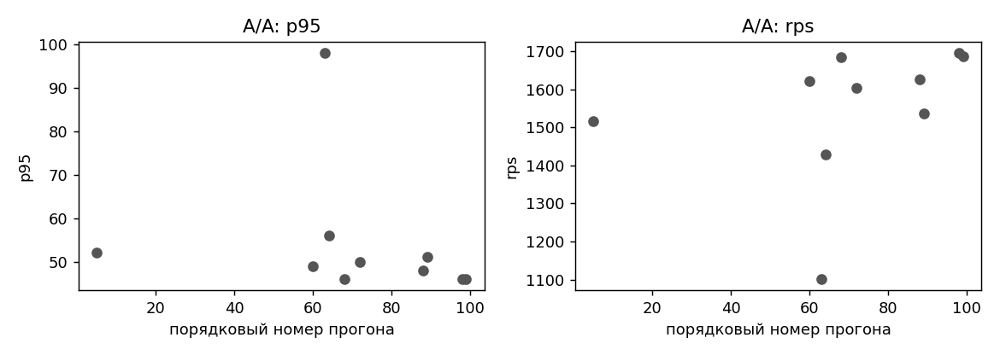
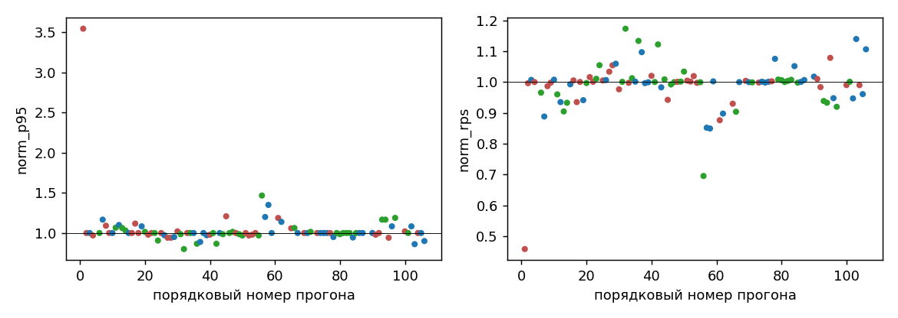
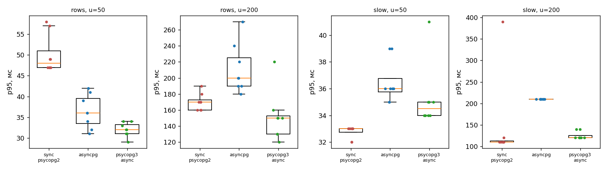
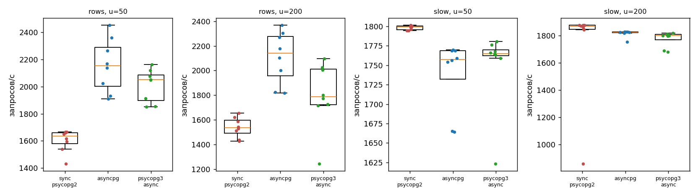
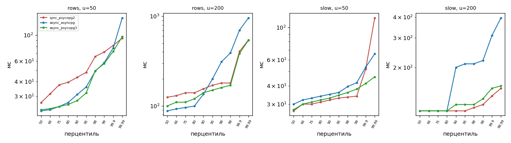

# Практическая работа № 4. Реализация, тестирование и оценка экспериментального стенда

**Тема ВКР:** Исследование влияния асинхронных драйверов баз данных на производительность FastAPI-приложений

**Авторы:** Диана Савельева, Елизавета Захаренко (работа выполнена в паре)

**Репозиторий:** https://github.com/zaharenkoliza/python_lab_4

**Предыдущая часть:** [docs/pr3-report.md](pr3-report.md) (копия отчёта ПР3; ссылки вида «раздел 4.1» и «[7]» относятся к нему)

---

## Содержание

1. Исследовательский вопрос, гипотезы и изменения проекта стенда
2. Реализация стенда
3. Воспроизведение эксперимента
4. Тестирование стенда
5. Результаты эксперимента
6. Оценка результатов и сравнение с литературой
7. Угрозы валидности и ограничения
8. Выводы и план развития стенда для ВКР
9. Ответы на вопросы для самопроверки

---

## 1. Исследовательский вопрос, гипотезы и изменения проекта стенда

### 1.1. Напоминание из ПР3

**RQ.** Как выбор драйвера БД (синхронный `psycopg2` в пуле потоков, асинхронные `asyncpg` и `psycopg 3`) влияет на пропускную способность и задержку p95 FastAPI-сервиса, ограниченного одним процессорным ядром, при разной конкурентности и разном типе запросов?

Гипотезы (ПР3, раздел 4.1):

* **H₁.** При конкурентности ≥ 50 для запросов `rows` асинхронные драйверы дают пропускную способность выше, а p95 ниже, чем `psycopg2`; ожидаемая величина — не менее 10 %.
* **H₂.** Для запросов `slow` (10 мс ожидания в БД) различий между драйверами нет, пока пропускная способность ограничена пулом: 20 соединений / 0,01 с ≈ 2000 запросов/с.
* **H₃.** При конкурентности 10 различия меньше порога практической значимости.
* **H₄.** В режиме `rows` `asyncpg` быстрее `psycopg 3`.

Критерий практической значимости (ПР3, раздел 4.4): отличие не менее 10 % и больше удвоенного коэффициента вариации по A/A-тесту.

### 1.2. Изменения по сравнению с ПР3

| Что | В ПР3 | В ПР4 | Причина |
|---|---|---|---|
| Генератор нагрузки | собственный клиент на aiohttp | Locust 2.31.5, 2 процесса, лимит 2 CPU | требование задания использовать стандартный инструмент; собственный генератор потребовал бы отдельной валидации |
| Уровни конкурентности | 10, 50, 200 | 50, 200 | сокращение времени эксперимента; следствие: **H₃ не проверялась** |
| Повторения | 10 | 8 на конфигурацию, 10 для A/A | ограничение по времени (106 прогонов заняли около 1 ч 25 мин) |
| Прогрев / измерение | 15 с / 60 с | 10 с / 30 с | то же |
| A/A-тест | две метки AA1 и AA2 по 10 прогонов | 10 прогонов одной конфигурации, случайное деление на две группы по 5 | соответствует формулировке задания; дополнительно оценена доля ложных срабатываний по 2000 случайным разбиениям |
| Структура репозитория | `app/`, `loadgen/`, `scripts/` | `sut/`, `load/`, `runner/`, `monitoring/` | структура, рекомендованная в задании |
| Мониторинг | не было | Prometheus, cAdvisor, Grafana; метрики SUT через `prometheus-fastapi-instrumentator` | требование задания; на время замеров мониторинг отключён (раздел 2.3) |
| Метод p95 | по каждому запросу | значения Locust по прогону | следствие смены генератора; влияние описано в разделе 7 |

Остальные параметры стенда не изменялись: 1 воркер uvicorn, ограничение SUT 1 ядром и 512 МиБ, пул 20 соединений для всех драйверов, лимит потоков AnyIO равен размеру пула, детерминированный набор данных из 10 000 строк, пересоздание контейнера SUT перед каждым прогоном.

---

## 2. Реализация стенда

### 2.1. Архитектура

```
 make experiment
       │
 runner/run_experiment.py ──(docker compose)──┐
       │ план, сид, манифест                   │
       ▼                                       ▼
 ┌───────────┐  HTTP   ┌──────────────┐  SQL  ┌────────────┐
 │ load      │────────►│ sut          │──────►│ db         │
 │ Locust    │         │ FastAPI +    │       │ PostgreSQL │
 │ 2 CPU     │         │ драйвер      │       │ 16.4, 2 CPU│
 └───────────┘         │ 1 CPU, 512 М │       └────────────┘
       │ CSV           └──────┬───────┘
       ▼                      │ /metrics
 results/raw/        ┌────────▼───────┐   ┌─────────┐  ┌─────────┐
 (CSV, манифесты)    │ prometheus     │◄──│cadvisor │  │ grafana │
       │             └────────────────┘   └─────────┘  └─────────┘
       ▼              (профиль monitoring, на время замеров выключен)
 analysis/analyze.py ──► results/processed/, docs/img/
```

### 2.2. Компоненты, версии и ограничения ресурсов

| Компонент | Версия | Ограничения |
|---|---|---|
| SUT: Python / uv | python:3.12.6-slim, uv 0.5.11 | 1 CPU, 512 МиБ, 1 воркер uvicorn |
| FastAPI / uvicorn | 0.115.0 / 0.30.6 | |
| Драйверы | psycopg2-binary 2.9.9; asyncpg 0.29.0; psycopg 3.2.1 + psycopg-pool 3.2.2 | пул 20 соединений |
| Метрики | prometheus-fastapi-instrumentator 7.0.0 | |
| БД | postgres:16.4, `shared_buffers=256MB`, `fsync=off`, `max_connections=100` | 2 CPU, 1 ГиБ |
| Генератор | locustio/locust:2.31.5, `--processes 2` | 2 CPU, 1 ГиБ |
| Prometheus / cAdvisor / Grafana | v2.54.1 / v0.49.1 / 11.2.0 | профиль `monitoring` |

Зависимости SUT зафиксированы в `sut/uv.lock`; сборка выполняется с флагом `--frozen`, поэтому при несоответствии lock-файла и `pyproject.toml` она завершается ошибкой. Образы указаны с конкретными тегами. Суммарное ограничение (1 + 2 + 2 = 5 ядер) укладывается в виртуальную машину Docker из 6 ядер.

Эндпоинты SUT: `/rows?start=N` (выборка 100 строк, сериализация в JSON), `/slow` (`SELECT pg_sleep(0.01)`), `/health`, `/metrics`.

### 2.3. Раннер и манифесты

Раннер `runner/run_experiment.py` читает `configs/experiment.yaml` и строит полный факторный план (драйвер × тип запроса × конкурентность × повторения) и прогоны A/A. Порядок прогонов перемешивается генератором с сидом из конфигурации. Для каждого прогона:

1. контейнер SUT пересоздаётся (`--force-recreate`) с нужным драйвером; ожидание готовности через healthcheck;
2. прогрев Locust (результаты не входят в анализ);
3. замер Locust; параллельно раз в ~2 с снимаются CPU и память SUT и генератора (`docker stats`);
4. записывается манифест.

Манифест (`results/raw/<run_id>.json`) содержит: параметры прогона, порядковый номер, повторение, сид, git-коммит и признак незафиксированных изменений, sha256 конфигурации и `uv.lock`, идентификаторы образов, платформу хоста, число ядер и объём памяти виртуальной машины Docker, версию Docker, время начала и конца. Сырые данные: `<run_id>_stats.csv` (Locust), `<run_id>_docker_stats.csv`, историю статистики Locust. Раннер возобновляем: прогоны с готовым манифестом пропускаются.

Мониторинг (Prometheus, cAdvisor, Grafana) включается командой `make smoke` и в основном эксперименте отключён (`monitoring: false`), чтобы дополнительные контейнеры не потребляли ресурсы виртуальной машины во время замеров. Загрузка процессора генератора и SUT в эксперименте измеряется `docker stats`.

### 2.4. Среда выполнения основного эксперимента

| Параметр | Значение |
|---|---|
| Машина | Apple M5, 10 ядер, macOS 26.5.2 (arm64) |
| Виртуальная машина Docker | Colima, 6 CPU, 8 ГиБ, ядро Linux 6.8.0, Docker Engine 29.5.2 |
| Docker Compose | 5.7.0 |
| Python раннера и анализа | 3.12.16 (uv 0.13.7); numpy 2.1.1, pandas 2.2.3, scipy 1.14.1, matplotlib 3.9.2 |
| Коммит кода стенда | f106815 (`git_dirty = false` в манифестах) |
| Время эксперимента | 08.11.2026, 20:27–21:52 (МСК), 106 прогонов |

После запуска эксперимента в `analysis/analyze.py` был добавлен раздел о чувствительности к выбросам (раздел 5.5); раннер и конфигурация не менялись.

---

## 3. Воспроизведение эксперимента

Полная инструкция приведена в [README.md](../README.md). Кратко:

```bash
make smoke        # проверка всех сервисов и метрик
make experiment   # весь эксперимент одной командой (≈1,5 ч)
make analyze      # статистика, графики -> results/processed/, docs/img/
```

Параметры эксперимента заданы только в `configs/experiment.yaml` (факторы и уровни, число повторений, прогрев, длительность, сид, размер пула). Сокращённый вариант `configs/ci.yaml` (~3 мин) запускается в CI (`.github/workflows/ci.yml`, GitHub Actions) командами `make smoke` и `make ci`. Результаты анализа основного эксперимента сохранены в `results/processed/` (сырые данные исключены из репозитория через `.gitignore` из-за объёма).

Проверка того, что окружение проверяющего совпадает с нашим: в манифесте каждого прогона записаны идентификаторы образов, хеш `uv.lock`, хеш конфигурации, версия Docker, число ядер виртуальной машины и коммит. Эти поля достаточно сравнить с манифестами проверяющего.

---

## 4. Тестирование стенда

### 4.1. Smoke-тест

`make smoke` поднимает БД, Prometheus, cAdvisor и Grafana, последовательно запускает SUT с каждым из трёх драйверов и проверяет: `/health` возвращает имя драйвера; `/rows` возвращает ровно 100 строк; `/slow` отвечает; `/metrics` содержит `http_requests_total`. Затем проверяется, что Prometheus видит цели в состоянии `up`, а Grafana отвечает. **Результат: пройден** (все три драйвера, две цели Prometheus: SUT и cAdvisor, Grafana работает). Отдельно перед основным экспериментом выполнен сокращённый прогон `make ci` (конвейер от раннера до анализа выполнился без ошибок).

### 4.2. A/A-тест

Десять прогонов одной конфигурации (`sync_psycopg2`, `rows`, 50 пользователей) выполнены в общем рандомизированном плане. Для анализа они случайно (по сиду) разделены на две группы по 5.

| Метрика | Медиана группы 1 | Медиана группы 2 | Отношение | δ Клиффа | p (Манн — Уитни) |
|---|---|---|---|---|---|
| p95, мс | 50 | 49 | 1,020 | +0,12 | 0,83 |
| Пропускная способность, запросов/с | 1605 | 1621 | 0,990 | −0,04 | 1,00 |

Значимого различия нет. Чтобы не опираться на одно случайное разбиение, мы повторили деление 2000 раз: доля срабатываний при α = 0,05 составила 3,5 % для p95 и 2,9 % для пропускной способности (ожидаемо около 5 %). Критерий пройден.

**Шум стенда.** Коэффициент вариации по 10 прогонам: 29,0 % для p95 и 11,6 % для пропускной способности. Эти значения завышены одним прогоном (порядковый номер 63: p95 = 98 мс при типичных 46–56 мс, пропускная способность 1101 запросов/с). Без него CV равен 6,8 % и 5,7 %; робастная оценка (IQR / 1,349 к медиане) по всем 10 прогонам — 7,9 % и 6,9 %. Причина выброса не установлена.

**Минимально обнаруживаемый эффект.** При n = 8, мощности 0,8 и α = 0,05 минимальный обнаружимый эффект приближённо равен 2,8·√(2/n)·CV. По CV без выброса это около 9,5 % для p95 и 8 % для пропускной способности; по CV всех 10 прогонов — около 40 % и 16 %. Мы принимаем первую оценку как основную, но приводим обе. Эффекты меньше 10 % данный стенд надёжно не обнаруживает.



*Рис. 1. A/A-тест: p95 и пропускная способность по порядковому номеру прогона.*

### 4.3. Узкое место генератора нагрузки

Критерий: загрузка процессора контейнера Locust ниже 80 % его лимита (2 CPU).

| Группа | Медиана, % лимита | Максимум, % лимита | Загрузка SUT, % ядра (медиана) | Критерий |
|---|---|---|---|---|
| A/A, `rows`, 50 | 19,8 | 27,5 | 102 | выполнен |
| `rows`, 50 | 25,2 | 31,6 | 100 | выполнен |
| `rows`, 200 | 25,5 | 32,3 | 100 | выполнен |
| `slow`, 50 | 21,9 | 33,3 | 40 | выполнен |
| `slow`, 200 | 22,9 | 56,1 | 43 | выполнен |

В режиме `rows` SUT загружен на 100 % выделенного ядра при низкой загрузке генератора, то есть ограничивает систему именно сервис. В режиме `slow` загрузка SUT составляет 28–55 %, а пропускная способность (1757–1869 запросов/с) близка к границе пула 2000 запросов/с, поэтому там ограничивает пул (раздел 5.2). Во всех 106 прогонах получено 5 697 603 запросов, ошибок нет. Замечание: `docker stats` даёт выборку раз в ~2 с, кратковременные пики он может не показать.

### 4.4. Стабильность во времени

Спирмен между порядковым номером прогона и значением метрики, нормированным на медиану своей конфигурации (96 основных прогонов):

| Метрика | ρ | p |
|---|---|---|
| p95 | −0,02 | 0,82 |
| пропускная способность | +0,06 | 0,54 |

Систематического тренда по всему плану нет. Внутри 10 прогонов A/A наблюдается слабая тенденция (для пропускной способности ρ = +0,66, p = 0,038; для p95 ρ = −0,62, p = 0,056). При n = 10 и четырёх проверенных критериях это могло возникнуть случайно, и по основным прогонам она не подтверждается, но мы отмечаем её как предупреждение (раздел 7).

На графике видны два заметных выброса: прогон № 1 (первый в плане: `sync_psycopg2`, `slow`, 200 пользователей, p95 = 390 мс, пропускная способность 856 запросов/с при типичных 110 мс и 1870) и прогон № 56 (`async_psycopg3`, `rows`, 200 пользователей, p95 = 220 мс при медиане 150 мс). Длительных эпизодов деградации, подобных пилоту ПР3 (раздел 6.8), не обнаружено. Правило ПР3 о перезапуске прогонов из эпизода деградации к одиночным выбросам неприменимо; вместо этого мы приводим результаты с выбросами и без них (раздел 5.5).



*Рис. 2. Нормированные p95 и пропускная способность по порядку прогонов (цвет — драйвер: красный `psycopg2`, синий `asyncpg`, зелёный `psycopg 3`).*

### 4.5. Повторяемость

Полный повторный запуск `make experiment` с нуля (около 1,5 ч) мы не выполняли. Косвенное подтверждение даёт A/A-тест и сопоставимость медиан ПР3-пилота и ПР4 в режиме `slow` (около 1800–1900 запросов/с в обоих). Для финального эксперимента ВКР полный повтор запланирован (раздел 8).

---

## 5. Результаты эксперимента

Единица наблюдения — прогон (значение p95 или пропускной способности за 30 с замера). План: 3 драйвера × 2 типа запроса × 2 уровня конкурентности × 8 повторений = 96 основных прогонов плюс 10 прогонов A/A. Полные таблицы: `results/processed/report.md`, `summary.csv`, `comparisons.csv`, `runs.csv`.

### 5.1. Сводка по конфигурациям

Медианы по прогонам; в скобках — 95 % bootstrap-интервал медианы (5000 ресэмплов). Задержки в мс.

| Запрос | Польз. | Драйвер | Пропускная способность, запросов/с | p95, мс | p95 IQR | p99, мс |
|---|---|---|---|---|---|---|
| `rows` | 50 | `sync_psycopg2` | 1634 (1539–1665) | 48,0 (47–57) | 4,0 | 71,5 |
| `rows` | 50 | `async_asyncpg` | 2152 (1968–2360) | 36,0 (32–40,5) | 6,0 | 58,0 |
| `rows` | 50 | `async_psycopg3` | 2050 (1854–2119) | 32,0 (31–34) | 2,3 | 57,0 |
| `rows` | 200 | `sync_psycopg2` | 1536 (1435–1619) | 170 (160–180) | 12,5 | 180 |
| `rows` | 200 | `async_asyncpg` | 2142 (1824–2303) | 200 (190–240) | 35,0 | 390 |
| `rows` | 200 | `async_psycopg3` | 1787 (1715–2025) | 150 (130–160) | 22,5 | 170 |
| `slow` | 50 | `sync_psycopg2` | 1799 (1795–1801) | 33,0 (32,5–33) | 0,3 | 34 |
| `slow` | 50 | `async_asyncpg` | 1758 (1665–1769) | 36,0 (35,5–39) | 1,0 | 42 |
| `slow` | 50 | `async_psycopg3` | 1765 (1759–1774) | 34,5 (34–35) | 1,0 | 38 |
| `slow` | 200 | `sync_psycopg2` | 1869 (1844–1878) | 110 (110–120) | 2,5 | 120 |
| `slow` | 200 | `async_asyncpg` | 1827 (1820–1829) | 210 (210–210) | 0,0 | 220 |
| `slow` | 200 | `async_psycopg3` | 1801 (1690–1814) | 120 (120–140) | 5,0 | 130 |



*Рис. 3. p95 по прогонам (точки — отдельные прогоны).*



*Рис. 4. Пропускная способность по прогонам.*



*Рис. 5. Перцентили задержки (медиана по прогонам, логарифмическая шкала).*

### 5.2. Сравнение драйверов

Для каждого сравнения указаны отношение медиан, δ Клиффа (величина эффекта) и p-значение критерия Манна — Уитни с поправкой Холма (24 сравнения). «Знач.» означает p_Holm < 0,05. Классификация δ: |δ| < 0,147 — пренебрежимый, < 0,33 — малый, < 0,474 — средний, иначе большой.

**Асинхронные драйверы против `psycopg2`, запрос `rows`.**

| Польз. | Драйвер | Пропускная способность: отношение, δ, p_Holm | p95: отношение, δ, p_Holm |
|---|---|---|---|
| 50 | `asyncpg` | 1,32; +1,00; 0,004 (знач.) | 0,75; −1,00; 0,013 (знач.) |
| 50 | `psycopg 3` | 1,25; +1,00; 0,004 (знач.) | 0,67; −1,00; 0,013 (знач.) |
| 200 | `asyncpg` | 1,40; +1,00; 0,004 (знач.) | **1,18**; +0,92; 0,029 (знач., p95 хуже) |
| 200 | `psycopg 3` | 1,16; +0,75; 0,104 (незнач.) | 0,88; −0,70; 0,115 (незнач.) |

**Асинхронные драйверы против `psycopg2`, запрос `slow`.**

| Польз. | Драйвер | Пропускная способность | p95 |
|---|---|---|---|
| 50 | `asyncpg` | 0,98; −1,00; 0,004 (знач.) | 1,09; +1,00; 0,011 (знач.) |
| 50 | `psycopg 3` | 0,98; −1,00; 0,004 (знач.) | 1,05; +1,00; 0,011 (знач.) |
| 200 | `asyncpg` | 0,98; −0,75; 0,104 (незнач.) | 1,91; +0,75; 0,072 (незнач.) |
| 200 | `psycopg 3` | 0,96; −0,75; 0,104 (незнач.) | 1,09; +0,66; 0,115 (незнач.) |

**`asyncpg` против `psycopg 3`.**

| Запрос | Польз. | Пропускная способность | p95 |
|---|---|---|---|
| `rows` | 50 | 1,05; +0,47; 0,261 (незнач.) | 1,13; +0,66; 0,115 (незнач.) |
| `rows` | 200 | 1,20; +0,72; 0,104 (незнач.) | 1,33; +0,83; 0,072 (незнач.) |
| `slow` | 50 | 1,00; −0,28; 0,382 (незнач.) | 1,04; +0,66; 0,115 (незнач.) |
| `slow` | 200 | 1,01; +0,81; 0,061 (незнач.) | 1,75; +1,00; 0,005 (знач.) |

Размер выборки (8 на группу) ограничивает мощность: при поправке Холма на 24 сравнения значимыми остаются 11. Значения δ при таких n легко достигают ±1, поэтому величину эффекта мы оцениваем вместе с отношением медиан, а не отдельно.

### 5.3. Практическая значимость

Порог ПР3 (раздел 4.4): не менее 10 % и не менее удвоенного CV шума. По CV A/A без выброса (6,8 % для p95 и 5,7 % для пропускной способности) порог составляет около 14 % для p95 и 11 % для пропускной способности; по CV всех 10 прогонов (29 % и 11,6 %) критерий в части p95 был бы недостижим (58 %), поэтому в основном выводе мы используем оценку без выброса.

* `rows`, 50 пользователей: оба асинхронных драйвера дают прирост пропускной способности на 25–32 % и снижение p95 на 25–33 %. Эффект практически значим.
* `rows`, 200 пользователей: `asyncpg` повышает пропускную способность на 40 %, но p95 хуже на 18 % (хвост: p99 390 мс против 180 мс у `psycopg2`). `psycopg 3` даёт +16 % пропускной способности и −12 % p95, однако при поправке Холма эти различия незначимы.
* `slow`: различия пропускной способности 2–4 % (ниже порога 10 %), хотя при 50 пользователях статистически значимы из-за очень малого разброса. Практически значимых различий нет. Исключение — p95 `asyncpg` при 200 пользователях (210 мс против 110 мс), статистически значимое только без выбросов (раздел 5.5).

### 5.4. Пропускная способность и пул (проверка H₂)

Расчётная граница для `slow`: 20 соединений / 0,01 с = 2000 запросов/с. Измеренные медианы лежат в диапазоне 1758–1869 запросов/с, то есть 88–93 % границы. Ни один драйвер не превзошёл границу, и ни одна асинхронная конфигурация не дала прироста более 10 % относительно `psycopg2` (отношение медиан 0,96–0,98). Предсказание не опровергнуто. По закону Литтла при 200 пользователях средняя задержка равна 200 / 1850 ≈ 108 мс, что совпадает с наблюдаемой p50 = 110 мс (то есть при 200 пользователях система насыщена, запросы ждут освобождения соединения в пуле).

### 5.5. Устойчивость к выбросам

По двум выбросам (прогоны № 1 и № 56, раздел 4.4) мы выполнили проверку: все сравнения пересчитаны без этих прогонов (`results/processed/comparisons_no_outliers.csv`). Критерий выбросов (p95 более чем в 1,4 раза выше медианы конфигурации либо пропускная способность ниже 0,7 медианы) задан после просмотра данных и используется только для проверки устойчивости, а не для замены основного анализа. Знак эффекта во всех сравнениях сохраняется, число значимых после поправки Холма сравнений возрастает с 11 до 19 из 24. Следовательно, выводы для 200 пользователей чувствительны к одиночным прогонам, и на уровне 8 повторений мы считаем значимыми только те различия, которые значимы в обоих анализах.

---

## 6. Оценка результатов и сравнение с литературой

### 6.1. Проверка гипотез ПР3

| Гипотеза | Результат |
|---|---|
| H₁: при конкурентности ≥ 50 на `rows` асинхронные драйверы выше по пропускной способности и ниже по p95 на ≥ 10 % | **Подтверждена частично.** Для 50 пользователей подтверждена полностью для обоих драйверов (+25…32 % пропускной способности, −25…33 % p95, p_Holm ≤ 0,013). Для 200 пользователей пропускная способность выше у обоих драйверов (+40 % и +16 %), но у `asyncpg` p95 оказался хуже на 18 %, а для `psycopg 3` различия по p95 и пропускной способности незначимы после поправки Холма (без двух выбросов они становятся значимыми: p_Holm 0,006 и 0,017, направление то же, раздел 5.5). |
| H₂: на `slow` различий нет из-за предела пула | **Не опровергнута.** Пропускная способность 88–93 % расчётной границы, разница между драйверами 2–4 %, ниже порога практической значимости. Небольшое статистически значимое преимущество `psycopg2` при 50 пользователях (+2 %) практического смысла не имеет. |
| H₃: при 10 пользователях различия ниже порога | **Не проверялась** (уровень 10 исключён из плана, раздел 1.2). |
| H₄: `asyncpg` быстрее `psycopg 3` на `rows` | **Не подтверждена.** Пропускная способность у `asyncpg` выше на 5 % (50 пользователей) и 20 % (200), но эти различия незначимы после поправки; p95 у `asyncpg` хуже на 13 % и 33 % (также незначимо, p_Holm 0,115 и 0,072). Направление эффекта зависит от метрики: `asyncpg` даёт больше запросов в секунду, но более тяжёлый хвост задержки. |

### 6.2. Сравнение с литературой

Мы сравниваем только по тем фактам, которые указаны в ПР3 (раздел 2.4).

* **[7] Grinberg (2020).** Автор показывает, что ранжирование sync и async зависит от числа сессий БД, задержки запроса и числа клиентов; лучший вариант оказался лишь примерно на 60 % быстрее базового. Наши результаты согласуются по направлению и порядку величины: выигрыш асинхронных драйверов есть при выборке и сериализации строк (+25…40 % пропускной способности), отсутствует при ожидании в БД, где предел задаёт пул, а ранжирование меняется с ростом конкурентности (`asyncpg` лучше по пропускной способности, но хуже по p95 при 200 пользователях).
* **[8] Arteaga (2024).** Источник утверждает, что `asyncpg` лучше во всех случаях; в ПР3 мы отметили, что таблицы автора этого не подтверждают. Наши данные также не поддерживают общее утверждение «`asyncpg` лучше»: по пропускной способности он впереди, но по p95 при 200 пользователях уступает `psycopg 3`. Прямое сопоставление чисел невозможно: у [8] 400 соединений, `wrk`, пул не указан, повторений нет; у нас 20 соединений в пуле и 1 CPU.
* **[6] Bednarz, Miłosz (2025).** Автор усредняет 5 повторений без разброса. У нас на `rows` при 50 пользователях разброс между повторениями (IQR p95 2–6 мс при медиане 32–48 мс, CV 5–11 %) сопоставим с частью обнаруженных различий (например, `asyncpg` против `psycopg 3` по p95), что подтверждает аргумент ПР3 о необходимости интервалов и тестов.
* **[1], [2], [5] (методология).** Подход этих работ реализован: несколько независимых прогонов, интервалы по бутстрэпу, непараметрический критерий и размер эффекта (в [5] — Варгха — Делэни, у нас δ Клиффа, близкая по смыслу мера), отдельный прогрев.

Абсолютные значения мы с литературой не сравниваем: в [6]–[8] другое железо, число воркеров, число соединений и СУБД.

### 6.3. Возможные объяснения результатов

Объяснения ниже — предположения; профилирование SUT мы не проводили.

* Прирост асинхронных драйверов на `rows` при загрузке SUT 100 %: у синхронного варианта каждый запрос проходит через пул потоков AnyIO, на одном ядре добавляются переключения потоков и конкуренция за GIL; в асинхронном варианте запросы обслуживает один цикл событий.
* Расхождение `asyncpg` и `psycopg 3` по хвосту: при 200 пользователях `asyncpg` показывает более длинный хвост (p99 390 мс против 170 мс) при более высокой пропускной способности. Возможная причина — неравномерная выдача соединений из пула при очереди ожидающих (в режиме `slow`, 200 пользователей, p95 `asyncpg` равен 210 мс при медиане 110 мс почти во всех прогонах). Проверка этого предположения потребует отдельного эксперимента.
* Отсутствие эффекта на `slow` объясняется пределом пула (раздел 5.4).

---

## 7. Угрозы валидности и ограничения

| Угроза | Проявилась ли | Влияние и меры |
|---|---|---|
| Перцентили Locust округляются (для значений ≥ 100 мс до двух значащих цифр: 110, 120, 210) | да | Разрешение p95 при 200 пользователях 5–10 мс, что сопоставимо с частью различий. Медиана по прогонам и bootstrap-интервалы частично сглаживают, но для финального эксперимента нужны сырые задержки по запросам. |
| Шум Docker в виртуальной машине на ноутбуке | да | Два одиночных выброса (прогоны № 1, 56) и A/A-выброс (№ 63). Рандомизация рассеивает их по конфигурациям, медианы и тесты устойчивы к ним; результат без выбросов приведён отдельно (5.5). Причины выбросов не установлены. |
| Холодный старт первого прогона | вероятно | Прогон № 1 — самое сильное отклонение; БД не пересоздавалась между прогонами, поэтому её кэши были холодными только в начале. Это объяснение не проверено. |
| Дрейф и тренд | нет по всему плану; слабая тенденция внутри A/A | см. 4.4 |
| Хост не был изолирован | возможно | Эксперимент шёл на рабочем ноутбуке; параллельный запуск нагрузки в той же виртуальной машине мы не допускали, но фоновые процессы macOS не контролировались. Кроме того, во время прогона на хосте один раз запускался анализ промежуточных данных. |
| Генератор как узкое место | нет | максимум 56 % лимита (4.3) |
| Недостаточная мощность | да | 8 повторений при 24 сравнениях; после Холма значимы 11. Результаты при 200 пользователях чувствительны к выбросам. |
| Одновременное изменение уровней (мониторинг, формат метрики) | ограниченно | Instrumentator одинаково влияет на все драйверы, но добавляет накладные расходы к абсолютным значениям. |
| Внешняя валидность | да | Один СУБД, 1 ядро, 1 воркер, синтетические запросы, пул 20, замкнутая модель нагрузки, одна машина. Выводы относятся только к этому классу условий. |
| Множественные сравнения | учтена | Поправка Холма для 24 сравнений. Четыре критерия стабильности (раздел 4.4) поправкой не покрывались. |
| Практический порог | частично | Порог по CV A/A зависит от выброса (4.2); мы указали обе оценки. |

**Ограничения стенда.** Нет профилирования SUT, поэтому объяснения (6.3) остаются гипотезами. Не выполнен полный повторный запуск. Мониторинг (Prometheus, cAdvisor) проверен только в smoke-тесте, но не использовался в эксперименте. Уровень конкурентности 10 исключён.

---

## 8. Выводы и план развития стенда для ВКР

**Выводы.**

1. Стенд воспроизводим: запускается одной командой, параметры вынесены в конфигурацию, сырые данные и манифесты сохраняются, анализ выполняется скриптом. A/A-тест пройден, генератор нагрузки не был узким местом (максимум 56 % лимита), общего тренда по плану нет.
2. На запросах с выборкой строк (`rows`) при 50 пользователях асинхронные драйверы дают на 25–32 % больше запросов в секунду и на 25–33 % меньший p95, чем `psycopg2` (гипотеза H₁ подтверждена для этих условий). При 200 пользователях преимущество по пропускной способности сохраняется, но по p95 картина неоднозначна.
3. На запросах с ожиданием в БД (`slow`) решающим фактором является размер пула, а не драйвер (гипотеза H₂ не опровергнута).
4. Утверждение «`asyncpg` быстрее `psycopg 3`» в наших данных не подтверждено: по пропускной способности `asyncpg` впереди, по p95 при 200 пользователях позади.
5. Стенд обнаруживает эффекты порядка 10 % и выше; меньшие эффекты (например, разница 2–4 % на `slow`) практического значения не имеют и интерпретировать их не следует.

**План для финального эксперимента ВКР.**

* Вернуть уровень 10 пользователей и добавить промежуточные уровни; увеличить число повторений до 15–20 и длительность замера до 60 с.
* Записывать задержку каждого запроса (собственный клиент либо расширение Locust), чтобы убрать округление перцентилей и строить ECDF.
* Выполнить профилирование SUT (py-spy) и проверить объяснения из раздела 6.3; добавить эксперимент с разными размерами пула, а также с несколькими воркерами.
* Запустить стенд на изолированной Linux-машине без посторонней нагрузки и сравнить с результатами на macOS.
* Выполнить полный повторный запуск с нуля (повторяемость), включить мониторинг и использовать метрики Prometheus/cAdvisor для проверки CPU генератора.
* Перед экспериментом задать критерий исключения выбросов в конфигурации.

---

## 9. Ответы на вопросы для самопроверки

**Каков шум стенда и какой минимальный эффект можно обнаружить?** CV между идентичными прогонами: 6–7 % без одного выброса и 12–29 % с ним; робастная оценка 7–8 %. Минимальный обнаружимый эффект при 8 повторениях около 8–10 % (при учёте выброса до 16–40 %).

**Что изменится, если не пересоздавать SUT между прогонами?** Прогоны перестанут быть независимыми: сохранятся состояние пула соединений, кэши и накопленные эффекты управления памятью. Разброс может уменьшиться, но результаты будут зависеть от порядка прогонов и истории; для сравнения конфигураций это опаснее, чем дополнительный шум.

**Как проверяющий узнает, что запустил то же окружение?** По манифестам: коммит и признак `git_dirty`, хеши конфигурации и `uv.lock`, идентификаторы образов, версия Docker, число ядер и объём памяти виртуальной машины.

**Какие результаты получатся на машине с вдвое меньшим числом ядер?** В нашей конфигурации виртуальной машине нужно 5 ядер (1 + 2 + 2), поэтому на 3 ядрах контейнеры начнут конкурировать между собой: генератор и БД будут отбирать процессор у SUT, абсолютная пропускная способность упадёт, а шум вырастет. Стенд придётся пересчитать: уменьшить лимиты генератора и БД и повторить проверку, что генератор не является узким местом.
